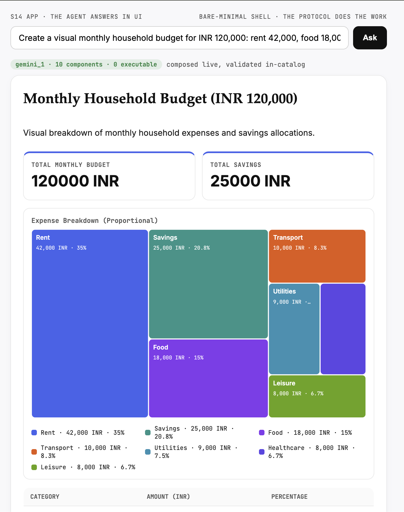

# S14Code

`S14Code` is the Session 14 runtime. It is the **entire Session 13 agent
runtime** — a live task graph, scoped and provenance-bearing memory, Rohan's
semantic chunking V2, and Agent2Agent interoperability — with the **Session 14
generative-UI layer folded in as one service**. There is no separate UI process:
the same FastAPI app that serves the agent API also serves the catalog,
validator, surface builder, AG-UI stream, and render client, reading the
runtime's graph **in-process**. It asks `glc_v3` for model completions over HTTP
and never owns provider credentials.

The load-bearing claim of Session 14, enforced by
[`s13code/ui/validator.py`](s13code/ui/validator.py):

> A surface is **declarative data**, checked against a catalog the client
> already trusts. Three invariants hold:
> - **catalog** — every component `type` is in the trusted catalog;
> - **data-not-code** — no property is ever evaluated as script, markup, or a URL;
> - **event** — the surface changes the world only by emitting a registered action.

The UI layer holds **no provider credentials**. It reads the graph the agent
already produced and calls no model directly; the generative path (the
`compose_surface` skill inside a live run) routes through the `glc_v3` gateway,
exactly as the rest of the runtime does.

## What runs where

Two services, not three. The Session 14 UI is part of the runtime on 8113.

| Service | Default address | Responsibility |
|---|---|---|
| `glc_v3` | `http://127.0.0.1:8111` | Models, keys, routing and channels (owns every credential) |
| `S14Code` HTTP | `http://127.0.0.1:8113` | Agent API (graph, memory, documents, JSON-RPC A2A) **and** the UI (catalog, validator, surface, AG-UI stream, render client) |
| `S14Code` gRPC | `127.0.0.1:8114` | Official A2A gRPC service |
| Ollama | `http://127.0.0.1:11434` | Phi-4 segmentation and Nomic embeddings |

## Requirements

- Python 3.11 or newer
- [`uv`](https://docs.astral.sh/uv/)
- A running `glc_v3` (for live runs and the generative UI loop)
- A running Ollama with `phi4` and `nomic-embed-text` (for live semantic chunking)

```bash
ollama pull phi4
ollama pull nomic-embed-text
ollama serve
```

The recorded proofs, invariant tests, and `/v1/harness/surface` need none of the
above — they replay real captured output.

## Install and run

```bash
uv sync

export GLC_BASE_URL=http://127.0.0.1:8111
export S13_GATEWAY_PROVIDER=gemini
export S13_SANDBOX_ROOT="$PWD/sandbox"
export S13_CHUNK_MODEL=phi4:latest
export S13_LIVE_SEMANTIC_CHUNKING=1

uv run s14code serve            # http://127.0.0.1:8113  (agent API + UI)
```

State is written under `~/.s13code` by default. Set `S13_DATA_DIR` to use
another directory.

Health, the trusted catalog, and the real harness-composed surface:

```bash
curl http://127.0.0.1:8113/healthz
curl http://127.0.0.1:8113/v1/catalog
open  http://127.0.0.1:8113/s/harness      # the render client, which executes nothing
```

## Run a prompt

```bash
curl -s http://127.0.0.1:8113/v1/agent/runs \
  -H 'Content-Type: application/json' \
  -d '{
    "tenant_id": "course",
    "project_id": "s14",
    "user_id": "student-01",
    "agent_id": "assistant",
    "prompt": "Say hello."
  }'
```

The response contains the final answer, graph nodes and edges, ordered graph
events, and provider/agent assignments. Once a run exists, the UI routes render
it straight from the in-process graph:

```bash
curl http://127.0.0.1:8113/v1/agent/runs/<run-id>       # the raw journal
curl http://127.0.0.1:8113/v1/runs/<run-id>/surface     # validated A2UI surface
curl http://127.0.0.1:8113/v1/runs/<run-id>/dashboard   # the rich showcase dashboard
curl http://127.0.0.1:8113/v1/runs/<run-id>/events      # AG-UI events over SSE
open  http://127.0.0.1:8113/s/<run-id>                   # render it in a browser
```

## The UI routes

All served by the runtime on 8113, defined in
[`s13code/ui/routes.py`](s13code/ui/routes.py):

| Route | Serves |
|---|---|
| `GET /v1/catalog` | the trusted component catalog |
| `GET /v1/runs/{id}/surface` | a validated declarative surface built from the in-process graph |
| `GET /v1/runs/{id}/dashboard` | the rich showcase dashboard, validated |
| `GET /v1/runs/{id}/events` | the S13 journal mapped to AG-UI events over SSE |
| `GET /v1/harness/surface` | the real surface a recorded S13 harness run composed (re-validated on serve) |
| `POST /v1/validate` | run any surface through the injection wall |
| `POST /v1/action` | a validated user action (approve/reject), bound to final params |
| `GET /s/{id}` | the render client, pointed at a run |

## The generative loop (UI composed by the harness)

The surface is composed by a **skill node inside a real live-graph run**, not by
a standalone prompt. The `compose_surface` skill lives in
[`s13code/runtime.py`](s13code/runtime.py) (grep `# --- S14 additive` and
`# --- S14 outcome-aware`) and imports the catalog and validator from
`s13code.ui`. A real run researches, distills, then composes the A2UI surface via
the gateway; the validator checks the model's own output.

```bash
# gateway on 8111 (provider=gemini); Ollama with nomic-embed-text for episode embedding
S13_GATEWAY_PROVIDER=gemini GLC_BASE_URL=http://127.0.0.1:8111 \
  uv run python proofs/harness_run.py          # -> proofs/harness_run.json

# the outcome-aware planner: weak evidence earns a corrective node before compose
S14_SELFCORRECT_CITY=Berlin GLC_BASE_URL=http://127.0.0.1:8111 \
  uv run python proofs/harness_selfcorrect.py  # -> proofs/harness_selfcorrect.json
```

## Proofs and tests

Everything the Session 14 widgets replay is real captured output under `proofs/`:

| File | Produced by | Shows |
|---|---|---|
| `proof.json` | `run_surface_proof.py` | injection wall (4 rejections), HITL, catalog/validator |
| `harness_run.json` | `harness_run.py` | a real live-graph run → the model composes a 19-component surface |
| `harness_selfcorrect.json` | `harness_selfcorrect.py` | the planner catches weak Berlin evidence and re-researches |
| `generated_surface.json` | `generate_live.py` | a local model's output caught by the validator |
| `gemini_surface.json` | `generate_gemini.py` | Gemini's raw output via the gateway |
| `treemap_run.json` | `treemap_run.py` | Gemini reaches for `Treemap` unprompted; the bound-value wall holds |

```bash
uv run python proofs/run_surface_proof.py    # writes proof.json, prints the table
uv run pytest -q                             # S13 core + regression tests + the S14 invariant tests
```

### Evidence: the `Treemap` component

`Treemap` is the catalog's 24th type and its 9th custom extension — a part-to-whole
view for two or more positive parts of one whole sharing a single unit.

**The request.** Captured live against `glc_v3`; the prompt never says "treemap",
so the model reaches for it from the catalog manifest alone. Synthetic identity
throughout.

```bash
curl -s 127.0.0.1:8113/v1/agent/runs -H 'content-type: application/json' -d '{
  "prompt": "Create a visual monthly household budget for INR 120,000: rent 42,000, food 18,000, transport 10,000, savings 25,000, healthcare 8,000, utilities 9,000, and leisure 8,000. Make the dominant costs immediately obvious.",
  "respond_as": "ui", "tenant_id": "course", "project_id": "s14-treemap",
  "user_id": "student-01", "agent_id": "assistant" }'
```

**The graph and its ordered event trace.** Two model calls, both served by the
`gemini_1` slot on `gemini-3.5-flash-lite` — every credential stayed in `glc_v3`.

| # | Event | Node |
|---|---|---|
| 0 | `run_started` | — |
| 1 | `graph_patched` | — |
| 2–3 | `task_started` → `task_succeeded` | `content` (agent `content`, `gemini_1`) |
| 4 | `graph_patched` | — |
| 5–6 | `task_started` → `task_succeeded` | `surface` (agent `ui_composer`, `gemini_1`) |
| 7 | `graph_patched` | — |

**The result.** The `content` role emitted a `breakdown` of 7 positive parts summing
to 120,000 INR; `_normalize_breakdown` accepted it and published `/breakdown`,
`/breakdown_total` and `/breakdown_unit`. The composer then built an 8-component
interface — `Column`, `Text` ×2, `Row`, `StatTile` ×2, **`Treemap`**, `DataTable` —
with the validator accepting 8 of 8 and rejecting none. The Treemap binds rather
than inlines:

```json
{ "id": "treemapSection", "type": "Treemap",
  "data": {"$bind": "/breakdown"}, "labelKey": "label", "valueKey": "value",
  "unit": {"$bind": "/breakdown_unit"} }
```

**The rendered surface.** The same prompt, run again through `/app` — the viewer
that renders `/composed` with `client/app.html`:



`Rent` dominates the picture because it dominates the budget, which is the entire
reason the type exists — a `BarChart` would have shown seven magnitudes and no
whole. Note the chip: **10** accepted components, not the 8 of the capture above.
Same prompt, same seven parts, a differently composed interface — the surface is
written per run, not chosen from a fixed set. What does not vary is that the model
reaches for `Treemap`. (The capture is one viewport; the `DataTable` continues below
the crop.)

**The three invariants, attacked.** `proofs/treemap_run.py` replays three hostile
surfaces through the same validator that guards the live path:

| Invariant | Attack | Validator's answer | Still renders |
|---|---|---|---|
| catalog | `Treemap` swapped for an uncatalogued `RawHtml` node | `unknown component type 'RawHtml'` | `root` |
| data-not-code | markup smuggled into the `dataModel` behind a `$bind` pointer | `bound value carries markup` | `root` |
| event | an unregistered action riding beside a clean `Treemap` | `unregistered action 'exfiltrate_memory'` | `root`, `tree` |

The third case is the one worth reading twice: the hostile `Button` is refused
while the clean `Treemap` beside it still renders. Refusal is per component, not
per surface.

**The adversarial before/after.** The middle attack is the one this change newly
defends against. The validator previously inspected only inline literals, so markup
that arrived *through* a `$bind` pointer reached the client untouched;
`_unsafe_bound_value` now resolves the pointer and refuses it. Reproducible with
git alone:

```bash
TREEMAP=$(git log --format=%H --grep='Add a Treemap component' -1)
git checkout "$TREEMAP^" -- s13code/ui/validator.py
uv run pytest tests/test_treemap_component.py -q   # before: 4 failed, 30 passed
git checkout HEAD -- s13code/ui/validator.py
uv run pytest tests/test_treemap_component.py -q   # after:  34 passed
```

The four that fail are exactly the bound-value cases:
`test_resolved_nested_markup_rejects_only_the_bound_component` and the three
parametrized `test_resolved_script_or_data_url_is_rejected` payloads.

**Reproduce from a fresh checkout.** The live capture needs `glc_v3` on 8111; the
tests need neither network nor gateway.

```bash
uv sync --dev
uv run pytest -q                          # 146 passed
uv run s14code serve                      # 8113, in a second terminal
uv run python proofs/treemap_run.py       # rewrites treemap_run.json, prints the invariant table
```

`treemap_run.py` fails loudly rather than writing a flattering file: if the model
does not reach for `Treemap` on its own, or the breakdown does not normalize, it
exits non-zero and writes nothing.

## Architecture

- `s13code/core/live_graph/`: durable graph state, patches, event replay and bounded parallel execution
- `s13code/core/memory/`: scope checks, provenance, contradiction history, semantic chunking and FAISS retrieval
- `s13code/core/a2a_adapter/`: Agent Cards, JSON-RPC, SSE/push, official gRPC and trust checks
- `s13code/gateway.py`: the only `S14Code → glc_v3` seam
- `s13code/runtime.py`: joins graph, memory, tools and model calls into an inspectable run; hosts the `compose_surface` skill
- `s13code/ui/`: the Session 14 layer — `catalog`, `validator`, `surface`, `showcase`, `agui`, `hitl`, `routes`, recorded `fixtures/`, and the `client/` render page
- `tests/`: executable invariants and regression cases

## Sharing / security

- Contains no secrets. The UI layer never reads `.env` and holds no credentials.
- `.venv/`, `__pycache__/`, any `.env`, and generated databases are git-ignored.
- Use synthetic identities in every proof.

## License

MIT. See `LICENSE`.
