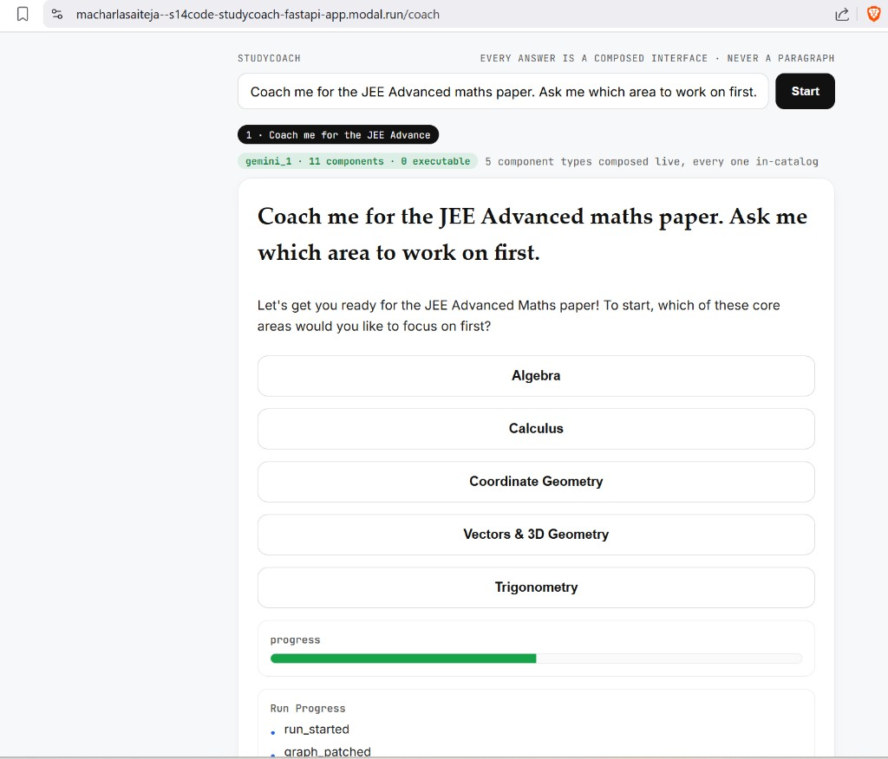

# S14Code

`S14Code` is the Session 14 runtime. It is the **entire Session 13 agent
runtime** — a live task graph, scoped and provenance-bearing memory, Rohan's
semantic chunking V2, and Agent2Agent interoperability — with the **Session 14
generative-UI layer folded in as one service**. There is no separate UI process:
the same FastAPI app that serves the agent API also serves the catalog,
validator, surface builder, AG-UI stream, and render client, reading the
runtime's graph **in-process**. It asks `glc_v3` for model completions over HTTP
and never owns provider credentials.

The load-bearing claim of Session 14, enforced by
[`s13code/ui/validator.py`](s13code/ui/validator.py):

> A surface is **declarative data**, checked against a catalog the client
> already trusts. Three invariants hold:
> - **catalog** — every component `type` is in the trusted catalog;
> - **data-not-code** — no property is ever evaluated as script, markup, or a URL;
> - **event** — the surface changes the world only by emitting a registered action.

The UI layer holds **no provider credentials**. It reads the graph the agent
already produced and calls no model directly; the generative path (the
`compose_surface` skill inside a live run) routes through the `glc_v3` gateway,
exactly as the rest of the runtime does.

## What runs where

Two services, not three. The Session 14 UI is part of the runtime on 8113.

| Service | Default address | Responsibility |
|---|---|---|
| `glc_v3` | `http://127.0.0.1:8111` | Models, keys, routing and channels (owns every credential) |
| `S14Code` HTTP | `http://127.0.0.1:8113` | Agent API (graph, memory, documents, JSON-RPC A2A) **and** the UI (catalog, validator, surface, AG-UI stream, render client) |
| `S14Code` gRPC | `127.0.0.1:8114` | Official A2A gRPC service |
| Ollama | `http://127.0.0.1:11434` | Phi-4 segmentation and Nomic embeddings |

## Requirements

- Python 3.11 or newer
- [`uv`](https://docs.astral.sh/uv/)
- A running `glc_v3` (for live runs and the generative UI loop)
- A running Ollama with `phi4` and `nomic-embed-text` (for live semantic chunking)

```bash
ollama pull phi4
ollama pull nomic-embed-text
ollama serve
```

The recorded proofs, invariant tests, and `/v1/harness/surface` need none of the
above — they replay real captured output.

## Install and run

```bash
uv sync

export GLC_BASE_URL=http://127.0.0.1:8111
export S13_GATEWAY_PROVIDER=gemini
export S13_SANDBOX_ROOT="$PWD/sandbox"
export S13_CHUNK_MODEL=phi4:latest
export S13_LIVE_SEMANTIC_CHUNKING=1

uv run s14code serve            # http://127.0.0.1:8113  (agent API + UI)
```

State is written under `~/.s13code` by default. Set `S13_DATA_DIR` to use
another directory.

Health, the trusted catalog, and the real harness-composed surface:

```bash
curl http://127.0.0.1:8113/healthz
curl http://127.0.0.1:8113/v1/catalog
open  http://127.0.0.1:8113/s/harness      # the render client, which executes nothing
```

## Run a prompt

```bash
curl -s http://127.0.0.1:8113/v1/agent/runs \
  -H 'Content-Type: application/json' \
  -d '{
    "tenant_id": "course",
    "project_id": "s14",
    "user_id": "student-01",
    "agent_id": "assistant",
    "prompt": "Say hello."
  }'
```

The response contains the final answer, graph nodes and edges, ordered graph
events, and provider/agent assignments. Once a run exists, the UI routes render
it straight from the in-process graph:

```bash
curl http://127.0.0.1:8113/v1/agent/runs/<run-id>       # the raw journal
curl http://127.0.0.1:8113/v1/runs/<run-id>/surface     # validated A2UI surface
curl http://127.0.0.1:8113/v1/runs/<run-id>/dashboard   # the rich showcase dashboard
curl http://127.0.0.1:8113/v1/runs/<run-id>/events      # AG-UI events over SSE
open  http://127.0.0.1:8113/s/<run-id>                   # render it in a browser
```

## The UI routes

All served by the runtime on 8113, defined in
[`s13code/ui/routes.py`](s13code/ui/routes.py):

| Route | Serves |
|---|---|
| `GET /v1/catalog` | the trusted component catalog |
| `GET /v1/runs/{id}/surface` | a validated declarative surface built from the in-process graph |
| `GET /v1/runs/{id}/dashboard` | the rich showcase dashboard, validated |
| `GET /v1/runs/{id}/events` | the S13 journal mapped to AG-UI events over SSE |
| `GET /v1/harness/surface` | the real surface a recorded S13 harness run composed (re-validated on serve) |
| `POST /v1/validate` | run any surface through the injection wall |
| `POST /v1/action` | a validated user action (approve/reject), bound to final params |
| `GET /s/{id}` | the render client, pointed at a run |

## The generative loop (UI composed by the harness)

The surface is composed by a **skill node inside a real live-graph run**, not by
a standalone prompt. The `compose_surface` skill lives in
[`s13code/runtime.py`](s13code/runtime.py) (grep `# --- S14 additive` and
`# --- S14 outcome-aware`) and imports the catalog and validator from
`s13code.ui`. A real run researches, distills, then composes the A2UI surface via
the gateway; the validator checks the model's own output.

```bash
# gateway on 8111 (provider=gemini); Ollama with nomic-embed-text for episode embedding
S13_GATEWAY_PROVIDER=gemini GLC_BASE_URL=http://127.0.0.1:8111 \
  uv run python proofs/harness_run.py          # -> proofs/harness_run.json

# the outcome-aware planner: weak evidence earns a corrective node before compose
S14_SELFCORRECT_CITY=Berlin GLC_BASE_URL=http://127.0.0.1:8111 \
  uv run python proofs/harness_selfcorrect.py  # -> proofs/harness_selfcorrect.json
```

## Proofs and tests

Everything the Session 14 widgets replay is real captured output under `proofs/`:

| File | Produced by | Shows |
|---|---|---|
| `proof.json` | `run_surface_proof.py` | injection wall (4 rejections), HITL, catalog/validator |
| `harness_run.json` | `harness_run.py` | a real live-graph run → the model composes a 19-component surface |
| `harness_selfcorrect.json` | `harness_selfcorrect.py` | the planner catches weak Berlin evidence and re-researches |
| `coach_turns.json` | `coach_turns.py` | StudyCoach's tapped turns + the forced injection refused (produced on demand; not committed, since it records one dated run) |
| `generated_surface.json` | `generate_live.py` | a local model's output caught by the validator |
| `gemini_surface.json` | `generate_gemini.py` | Gemini's raw output via the gateway |

```bash
uv run python proofs/run_surface_proof.py    # writes proof.json, prints the table
uv run pytest -q                             # S13 core + regression tests + the S14 invariant tests
```

## Architecture

- `s13code/core/live_graph/`: durable graph state, patches, event replay and bounded parallel execution
- `s13code/core/memory/`: scope checks, provenance, contradiction history, semantic chunking and FAISS retrieval
- `s13code/core/a2a_adapter/`: Agent Cards, JSON-RPC, SSE/push, official gRPC and trust checks
- `s13code/gateway.py`: the only `S14Code → glc_v3` seam
- `s13code/runtime.py`: joins graph, memory, tools and model calls into an inspectable run; hosts the `compose_surface` skill
- `s13code/ui/`: the Session 14 layer — `catalog`, `validator`, `surface`, `showcase`, `agui`, `hitl`, `routes`, recorded `fixtures/`, and the `client/` render page
- `tests/`: executable invariants and regression cases

## Sharing / security

- Contains no secrets. The UI layer never reads `.env` and holds no credentials.
- `.venv/`, `__pycache__/`, any `.env`, and generated databases are git-ignored.
- Use synthetic identities in every proof.

## Assignment: the StepWizard component and the StudyCoach application

Two parts in one pull request. Part 1 adds `StepWizard` to the shared catalog.
Part 2 builds **StudyCoach**, an application that answers only by composing an
interface. Synthetic identities throughout: `tenant_id=course`,
`project_id=s14-studycoach`, `user_id=learner-07`, `agent_id=study_coach`.

### Part 1 — `StepWizard`, in the three places a component lives

A2UI Basic can render an ordered list, but nothing in the catalog could say
**where you are inside an ordered process**. `StepWizard` carries that one extra
fact, which is what a lesson plan, a revision sequence, or a multi-stage
derivation actually needs.

| Place | What was added |
|---|---|
| `s13code/ui/catalog.py` | `ComponentSpec("StepWizard", …, source="custom")` — `title` (`text`), `steps` (`binding`), `active` (`binding`), `advance` (`action`) |
| `s13code/ui/client/index.html` | `renderWizard` — numbered rail with done/current state plus a detail panel, built from `createElement` + text nodes |
| `s13code/ui/client/app.html`, `coach.html` | `wizard` — the same renderer in both application shells |

The catalog is now **24 types**: the 15 A2UI-Basic names plus 9 custom
extensions.

**Composed unprompted.** `compose_surface` publishes `/steps`
(`[{label, detail}]`) and `/active_step` as *data* derived from the content
role's ordered sections, and the component-mapping instruction was generalised
to "pick whichever catalog component conveys ordered progress best — read the
catalog and choose". The engine never says the word `StepWizard`:
`test_compose_prompt_never_names_stepwizard_so_the_model_must_choose_it`
asserts `"StepWizard" not in s13code/runtime.py` while
`catalog_manifest()` still offers it. The model can only find it by reading the
catalog it is handed.

**The three invariants hold for it** (`tests/test_s14_ui.py`):

| Invariant | Attack on the new component | Result |
|---|---|---|
| catalog | `type: "StepWizardRaw"` / `type: "Wizard"` | rejected — `unknown component type` |
| data-not-code | `title: ""` | rejected — `value carries markup` |
| data-not-code | `steps: "<script>…</script>"` (inline where a binding belongs) | rejected — `binding must be {'$bind': '/pointer'}` |
| data-not-code | extra `onclick` property | rejected — `event-handler property is never allowed` |
| event | `advance: {"action": "exfiltrate_memory"}` | rejected — `unregistered action` |
| — | a poisoned `StepWizard` beside a clean `Text` | wizard dropped, heading still renders |

### Part 2 — StudyCoach, a UI-only application

`GET /coach` (`s13code/ui/client/coach.html`). Domain: exam preparation
coaching. The learner states a goal; **every turn is a composed,
catalog-validated interface and never a paragraph**. A tap is the next turn's
prompt, so turn three is shaped by what was tapped in turns one and two. A turn
rail keeps each composed interface so an earlier turn can be revisited without
asking the model to compose it again.

The loop is the protocol, not application code: `POST /v1/agent/runs` with
`respond_as: "ui"` → the graph runs `content` → `compose_surface` → the shell
reads `GET /v1/runs/{id}/composed` and renders it.

Turn one on the deployed app, composed live by `gemini_1`:



The status line is the receipt: `gemini_1 · 11 components · 0 executable`, and
`5 component types composed live, every one in-catalog`. Nothing in that page is
a paragraph the model wrote — the prose is bound `Text`, the subjects are
`Button`s whose taps become turn two's prompt, and the `Timeline` is the run's own
`run_started` / `graph_patched` journal. `0 executable` is counted, not asserted:
it is the number of accepted components carrying markup, a URL, a handler prop or
an unregistered action.

### Four defects in the reference build that this branch fixes

All four were found by running the thing rather than reading it, and the first two
were load-bearing for the invariant the session claims.

1. **The app shell rendered model-adjacent markup.** `app.html` set
   `status.innerHTML` with the learner's own goal interpolated into it, so a goal
   typed as `` executed in the shell *around* a perfectly
   clean interface. The status line is now DOM built from text nodes;
   `test_app_viewer_status_line_is_dom_not_markup` locks it.
2. **The validator never checked `children`.** It skipped the field, so a
   nested component *object* inside `children` was never checked against the
   catalog, and `compose_surface` crashed outright
   (`TypeError: unhashable type: 'dict'`) the first time a live model returned
   that shape. `children` are now enforced as a list of component-id strings;
   a nested object is a `data-not-code` rejection.
3. **A truncated reply lost the whole interface.** A model that stops
   mid-component returns HTTP 200 with no stop reason, so a cut-off reply is
   indistinguishable from a finished one. `json.loads` failed and the turn rendered
   nothing — which a UI-only application cannot survive. The finished components
   are now recovered, dangling child refs dropped, and the composer retries once.
4. **A tapped label was mistaken for a research fan-out.** A chip reading
   `Algebra (Complex Numbers, Quadratic Equations, …)` was parsed as a
   comma-separated entity list, so **one** conversational turn fanned into six
   model calls and built a graph with no `compose_surface` node in it at all. An
   explicit `respond_as: "ui"` turn now always takes the single-goal path; the
   fan-out is kept for phrased requests, where the commas are the author's own list.

### Reproduce from a fresh checkout

```bash
# terminal one — the gateway owns the one provider credential
cd glc_v3 && uv sync && uv run glc serve

# terminal two — the Session 14 runtime
cd S14Code && uv sync
uv run ruff check .
uv run pytest -q                      # 137 tests
export GLC_BASE_URL=http://127.0.0.1:8111
export S13_GATEWAY_PROVIDER=gemini
uv run s14code serve

# the application
open http://127.0.0.1:8113/coach

# the component's invariants on their own
uv run pytest -q tests/test_s14_ui.py -k stepwizard
```

## Hosted deployment

Two Modal apps, keeping the same boundary the local setup has: the gateway owns
the provider credential, the runtime never sees one.

| App | Serves | Secret it reads |
|---|---|---|
| `glc-v1-gateway` | `glc.main:app` — models, keys, routing, cost | `glc-llm-keys` (`GEMINI_API_KEY_1`) |
| `s14code-studycoach` | `s13code.main:app` — `/coach` and the UI routes | `s14code-gateway` (`GLC_BASE_URL` only, no credential) |

[`modal_app.py`](modal_app.py) makes two choices a serverless container forces,
both by environment rather than by changing application code:

- `S13_EMBEDDER=deterministic` — there is no Ollama sidecar in the container, and
  an embedder that cannot be reached fails every memory write. Locally the real
  `nomic-embed-text` embedder is still the default.
- `S13_A2A_GRPC_ENABLED=0` — a second listener on its own port is unreachable
  through Modal's single ASGI ingress. The JSON-RPC A2A surface stays on HTTP.

```bash
# the gateway (its image must include ./static — glc/main.py mounts it at import
# time, so a missing directory kills the container before the app exists)
cd glc_v3
modal secret create glc-llm-keys GEMINI_API_KEY_1=... LLM_ORDER=gemini
uv run modal deploy modal_app.py

# the runtime, pointed at the deployed gateway
cd ../S14Code
modal secret create s14code-gateway GLC_BASE_URL=https://<gateway-host>
uv run modal deploy modal_app.py
```

## License

MIT. See `LICENSE`.
